# Video Console

把腳本拆成分鏡，逐鏡生圖、圖轉影片，再在時間軸上剪成一支 MP4。生圖、生影片都可以走 ComfyUI（本機，或區網、VPN 上的另一台電腦）或雲端 API；本機影片範本是 LTX-Video 2B 蒸餾版（480P，一次最多約 10.7 秒）。

介面在瀏覽器（Chrome 應用程式視窗，沒有 Chrome 時改用 Edge）裡執行，後端是本機 Python 伺服器，只接受 127.0.0.1 連線。

已知限制與未驗證的部分集中列在 [GAPS.md](GAPS.md)，使用前請先看一遍。

## 介紹影片

[](https://youtu.be/LozZDUHJzOg)

▶ [在 YouTube 觀看「Video Console AI 影片剪輯工具」](https://youtu.be/LozZDUHJzOg)

## 畫面導覽

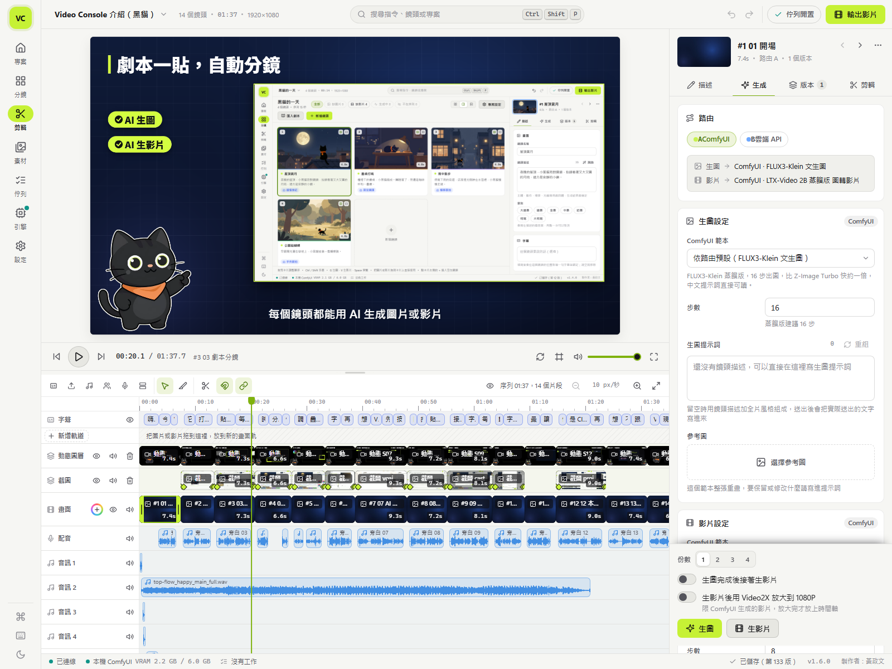

**剪輯**：上方即時預覽，下方時間軸由上而下是字幕、多條畫面軌、配音與四條音訊軌；右側是選取鏡頭的屬性與生成設定。

<table>
  <tr>
    <td width="50%">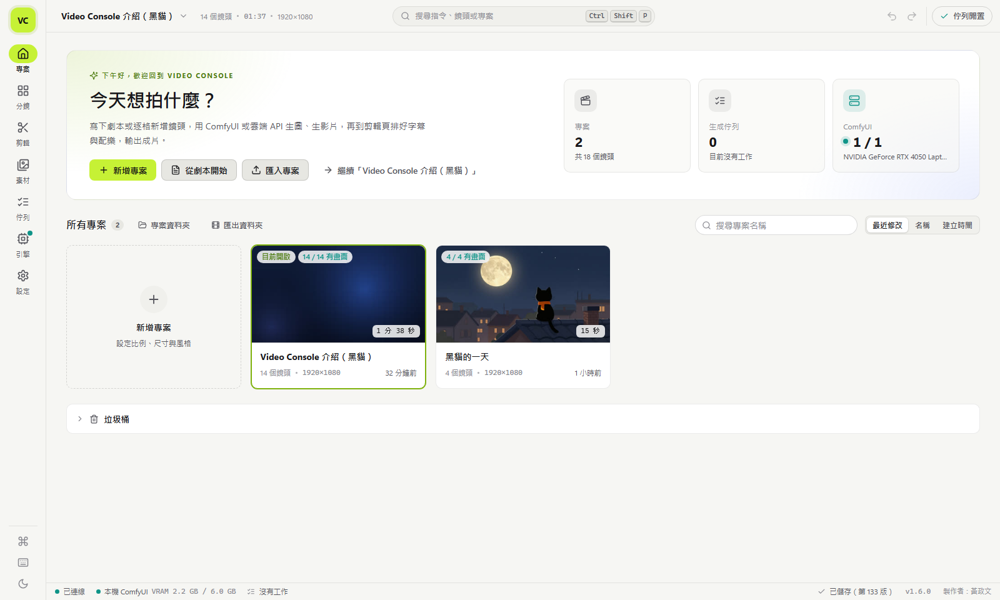</td>
    <td width="50%">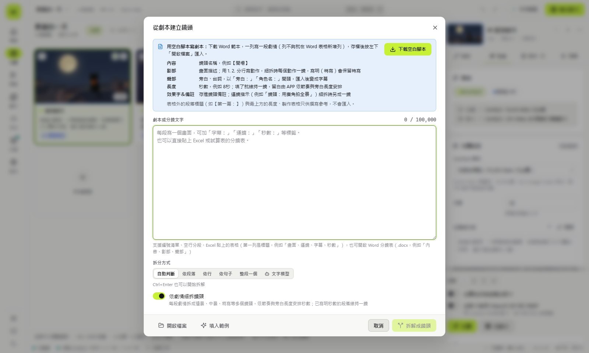</td>
  </tr>
  <tr>
    <td><b>專案首頁</b>：新增專案、從劇本開始或匯入專案，上方顯示專案數、生成佇列與 ComfyUI 顯示卡狀態。</td>
    <td><b>從劇本建立鏡頭</b>：貼上劇本或 Excel 分鏡表、開啟 Word 檔，選拆分方式（自動、段落、行、句子、文字模型）；也能下載空白 Word 腳本照欄位填寫。</td>
  </tr>
  <tr>
    <td>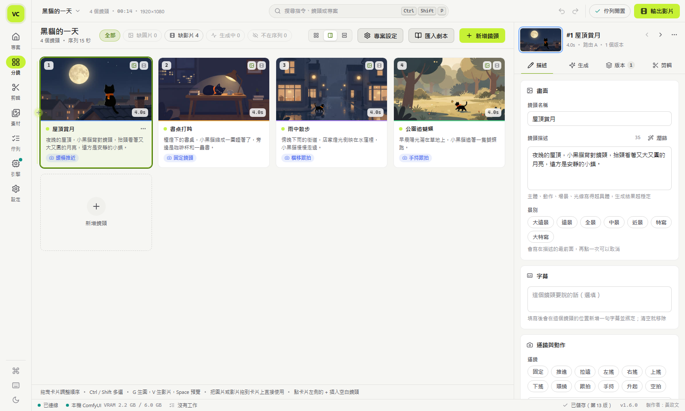</td>
    <td>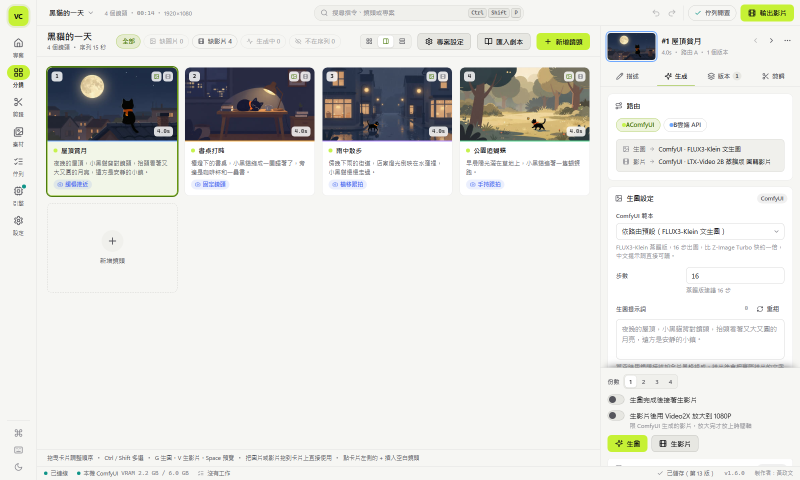</td>
  </tr>
  <tr>
    <td><b>分鏡</b>：每個鏡頭一張卡片，顯示畫面、描述、運鏡與秒數，拖曳調整順序；右側填鏡頭描述、景別、字幕與運鏡。</td>
    <td><b>生成</b>：選路由（ComfyUI 或雲端 API）、範本、步數與提示詞，按「生圖」「生影片」排進佇列；可以勾選生圖後接著生影片、用 Video2X 放大到 1080P。</td>
  </tr>
  <tr>
    <td>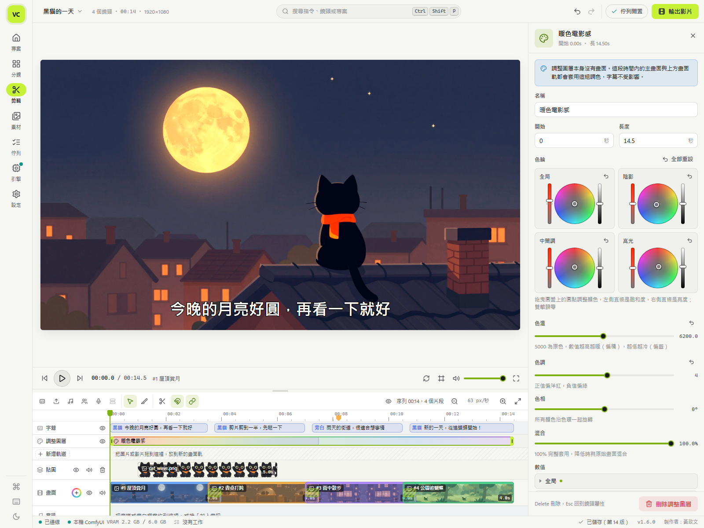</td>
    <td>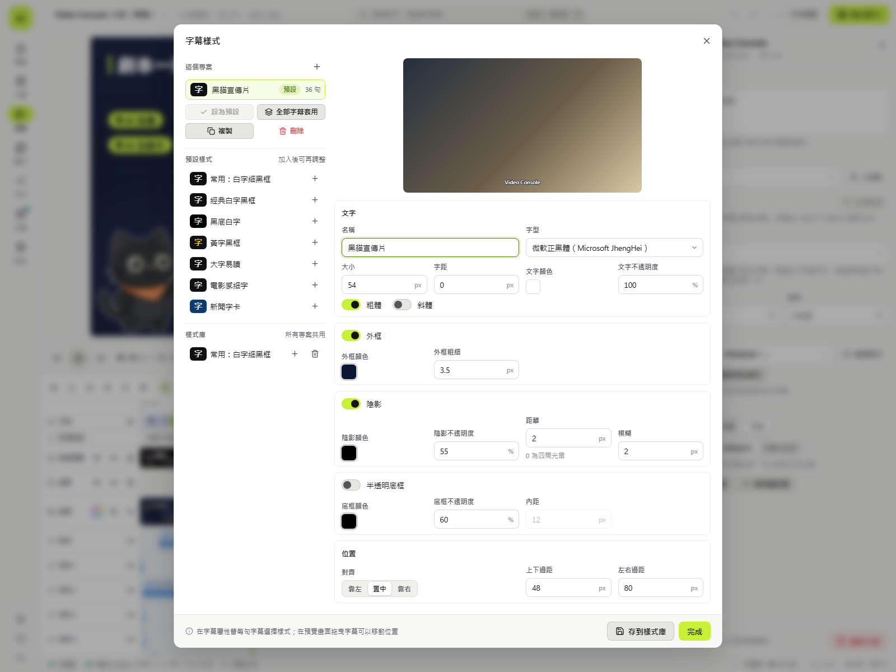</td>
  </tr>
  <tr>
    <td><b>調色</b>：在調整圖層上用四個色輪（全局、陰影、中間調、高光）、色溫、色調、色相與混合比例調色，預覽即時套用，輸出時烘成 LUT。</td>
    <td><b>字幕樣式</b>：字型、大小、外框、陰影、半透明底框與位置，內建 7 組預設樣式；存進樣式庫後所有專案共用。</td>
  </tr>
  <tr>
    <td>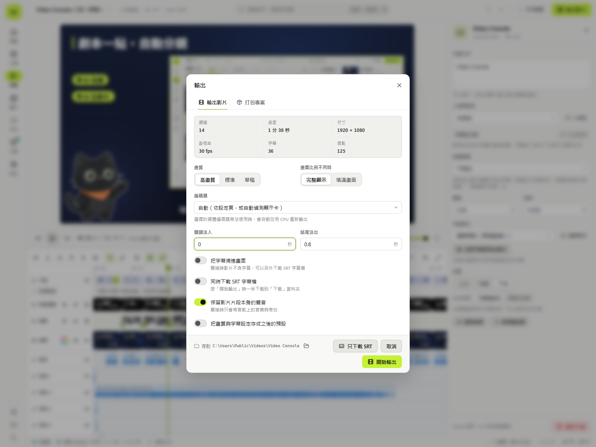</td>
    <td>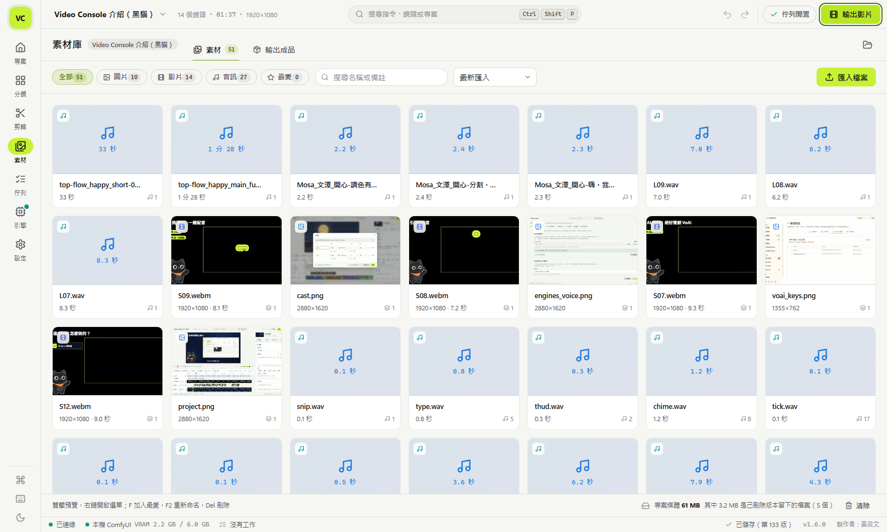</td>
  </tr>
  <tr>
    <td><b>輸出</b>：選畫質、編碼器與淡入淡出，可以把字幕燒進畫面、同時下載 SRT，或只下載 SRT；「打包專案」分頁把整個專案打包成 ZIP。</td>
    <td><b>素材庫</b>：圖片、影片、音訊分類篩選與搜尋，雙擊預覽、F 加入最愛、F2 重新命名；「輸出成品」分頁列出所有輸出檔。</td>
  </tr>
  <tr>
    <td>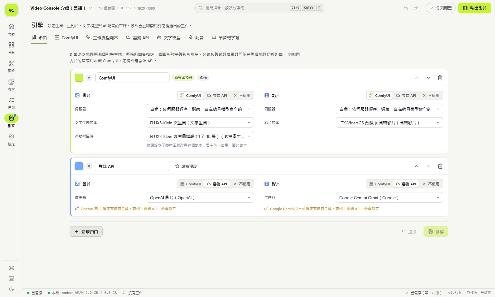</td>
    <td>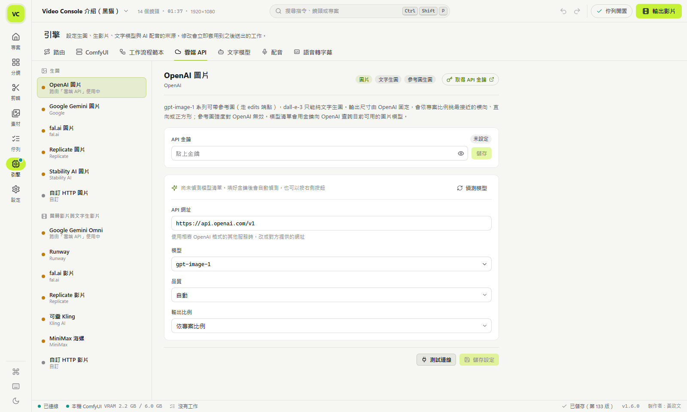</td>
  </tr>
  <tr>
    <td><b>路由</b>：每條路由各自指定圖片與影片走 ComfyUI 範本或雲端 API；預設 A 走本機 ComfyUI、B 走雲端，鏡頭可以個別切換。</td>
    <td><b>雲端 API</b>：OpenAI、Google Gemini、fal.ai、Replicate、Stability AI、Runway、可靈、MiniMax 與自訂 HTTP，各一張設定卡片，填金鑰後按「測試連線」。</td>
  </tr>
</table>

## 搭配工具：Speech-to-subtitle 語音轉字幕

[**Speech-to-subtitle**](https://github.com/nice923boss/Speech-to-subtitle) 是作者另一個開源專案（MIT），把影片或音檔批次轉成 SRT 字幕的 Windows 桌面工具。Video Console 剪輯頁的「轉成字幕」就是呼叫它辨識影片原聲；它也可以單獨開視窗批次轉檔。

- 用 faster-whisper（Whisper large-v3）轉錄，語言自動偵測，或指定中、英、日、韓等語言。
- 有 Montreal Forced Aligner（MFA）時做詞級對齊；沒有時用音訊能量把字幕開頭對到實際開口的時間。
- 中文輸出經 OpenCC 轉成臺灣正體。
- 偵測 Whisper 在音樂、歌唱段落反覆輸出同一句的情形，只重新解碼那一段。
- 每個檔案在自己的子行程轉錄，顯示卡驅動崩潰只影響該檔，批次繼續跑下一個。
- 需要 NVIDIA 顯示卡（只走 CUDA，沒有 CPU 模式）、Python 3.12 與 large-v3 模型（約 3 GB，安裝腳本可代為下載）。

搭配 Video Console 的設定方式：

1. 把 Speech-to-subtitle 下載到和 Video Console 同一層的資料夾，例如 `D:\Tools\Video Console` 旁邊的 `D:\Tools\Speech-to-subtitle`：

   ```bash
   git clone https://github.com/nice923boss/Speech-to-subtitle.git
   ```

   不用 git 的話，在 GitHub 頁面按 **Code › Download ZIP** 解壓縮，資料夾名稱改成 `Speech-to-subtitle`。
2. 執行 Speech-to-subtitle 資料夾裡的 `安裝依賴.bat`，看到「可以執行 start.bat 開啟 App」即完成。
3. 回到 Video Console「引擎」頁「語音轉字幕」分頁按「檢查」。放在同一層時，資料夾與 Python 兩欄都可以留白。

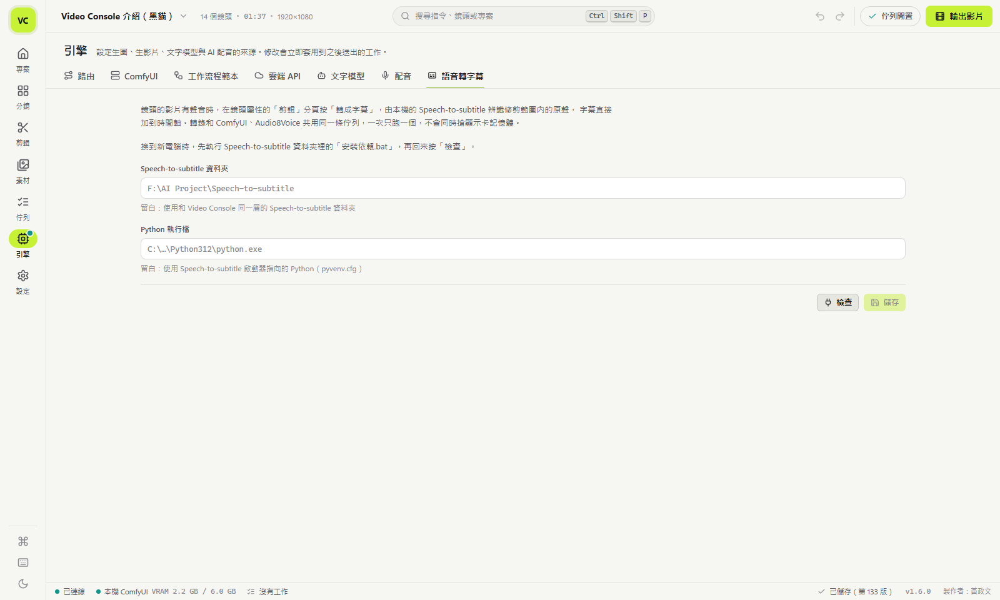

## 需求

| 項目 | 說明 |
|---|---|
| 作業系統 | Windows 10 / 11（64 位元） |
| 瀏覽器 | Google Chrome 或 Microsoft Edge（優先用 Chrome；都找不到時改用預設瀏覽器開分頁） |
| ffmpeg（必要） | 輸出影片、擷取畫面、產生縮圖。在 APP 內一鍵安裝（約 31 MB），或沿用電腦上已有的 ffmpeg |
| ComfyUI（選用） | 本機或其他電腦上的 ComfyUI，預設連 `http://127.0.0.1:8000` |
| Video2X（選用） | 把 ComfyUI 生的 480P 影片放大到 1080P。在 APP 內安裝 6.4 版可攜版（約 197 MB），或沿用裝在 `C:\Program Files\Video2X Qt6` 的版本 |
| Speech-to-subtitle（選用） | 影片原聲轉字幕，需要 NVIDIA 顯示卡。另一個開源專案，安裝方式見上方「搭配工具」 |
| Python（只有從原始碼執行才需要） | 3.10 以上（安裝時勾選 Add python.exe to PATH） |

## 安裝與啟動

### 下載執行檔（不用裝 Python）

1. 到 [Releases](https://github.com/nice923boss/video-console/releases) 下載 `VideoConsole-<版本>-win64.zip`，解壓縮到可以寫入的位置，例如「文件」或「桌面」。不要放在 `C:\Program Files`，程式旁邊要能建立 `data` 資料夾。
2. 執行 `Video Console.exe`，會開出一個應用程式視窗。執行檔沒有數位簽章，第一次開啟時 Windows 可能顯示「Windows 已保護您的電腦」，按「其他資訊」再按「仍要執行」。
3. 到左側「設定」頁的「依賴元件」，按「一鍵安裝」下載 ffmpeg；要把影片放大到 1080P，再按 Video2X 那一列的「安裝」。下載來源固定（imageio-ffmpeg 在 PyPI 的 wheel、Video2X 在 GitHub 的官方發行版），先比對 SHA-256，相符才解壓縮到 `data/tools`，不需要系統管理員權限。電腦上已經有 ffmpeg 或 Video2X 時會直接使用，狀態顯示「就緒」。

### 從原始碼執行

1. 安裝 Python 3.10 以上。
2. 執行 `啟動 Video Console.bat`。ffmpeg 一樣可以在「依賴元件」一鍵安裝；也可以執行 `安裝相依套件.bat`，改用 pip 安裝 imageio-ffmpeg（已經裝過的套件會略過，不會強制升級）。
3. 要立刻停止，執行 `停止 Video Console.bat`。

### 執行中的行為

- 已經在執行時，再開一次會另開一個視窗連到同一個伺服器，不會啟動第二份。
- 關掉視窗後，Video Console 留在系統托盤，佇列裡的工作繼續跑。點兩下托盤圖示重開視窗，右鍵選單的「結束 Video Console」完全結束。
- 用 `--no-window` 在背景啟動（Claude 或工具操作時）沒有托盤圖示；沒有視窗、也沒有工作超過 2 分鐘，就會自己結束。這時從桌面開啟會補上托盤圖示。執行檔版要立刻停止，在命令列執行 `"Video Console.exe" --stop`。
- 連接埠從 8790 開始找，被占用就往後找到 8799。實際位址記在 `data/run/server.json`。

命令列參數（`"Video Console.exe" ...` 或 `python app/main.py ...`）：

| 參數 | 用途 |
|---|---|
| `--no-window` | 只啟動伺服器，不開視窗 |
| `--stop` | 停止執行中的副本 |
| `--port N` | 只用這個連接埠，被占用就不啟動 |
| `--data 資料夾` | 指定資料夾（也可以用環境變數 `VC_DATA_DIR`） |
| `--verbose` | 記錄除錯訊息 |

## 第一次設定

全部在左側「引擎」頁完成。

### ComfyUI

- 「ComfyUI」分頁預設只有本機 `http://127.0.0.1:8000`。可以新增其他電腦（例如透過 Tailscale 連線的工作站）、停用、調整順序；路由設成「自動」時，工作會派給清單中第一台在線、而且具備範本所需模型與節點的伺服器。
- 每台伺服器會顯示連線狀態與顯示卡記憶體，可以重新檢查、釋放顯示卡記憶體、中斷目前工作。
- 「工作流程範本」分頁管理 workflow。內建範本：FLUX3-Klein 文生圖、版面配置海報、參考圖編輯（1 到 10 張），Z-Image Turbo 文生圖、圖生圖、像素風、LTX-Video 2B 圖轉影片、放大（UltraSharp、Z-Image 細修）。影片範本可以設定影格數規則、最多影格數、建議影格率與短邊上限。也可以匯入自己的 ComfyUI API 格式 JSON，再把提示詞、種子、尺寸、輸入圖片等欄位綁到節點上。
- FLUX3-Klein 範本來自 ComfyUI 的「FLUX3-Klein進階」工作流（FK-01 到 FK-04，FK-03 單圖編輯與 FK-04 多圖合成併成一個「參考圖編輯」範本），需要三個模型檔：`flux3-image-klein-int8-convrot.safetensors`（放 diffusion_models，約 5.8GB）、`qwen3vl_4b_int8_convrot.safetensors`（放 text_encoders，約 4.9GB）、`flux2-vae.safetensors`（放 vae，約 0.3GB）。中文提示詞直接可讀，不用翻譯。RTX 4050 Laptop 6GB 實測 1280×720：從 APP 送出，文生圖約 14 秒、參考圖編輯 2 張約 52 秒（都是模型已載入）；直接送 ComfyUI，參考圖編輯 2 張約 107 秒，10 張、參考圖解析度 0.5 約 221 秒。路由 A 要改回 Z-Image，在「路由」分頁把生圖範本換回 Z-Image 範本即可。
  - 參考圖編輯：鏡頭「生成」分頁的參考圖區可放 1 到 10 張（第 1 張是原本的參考圖，按「新增」從版本或素材庫挑其餘幾張），提示詞用「第一張圖的…」「第二張圖的…」指名要取哪個人物、物件或場景。Klein 是整張重畫，沒有參考強度，這個範本不顯示參考強度滑桿；要保留什麼請寫進提示詞。張數多時把範本參數「參考圖解析度」調低，省顯示卡記憶體與時間。改用只讀一張的範本（例如 Z-Image 圖生圖）時，參考圖區會提示其餘幾張會略過；文生圖範本則提示不使用參考圖。
  - 版面配置海報：範本參數「元素表」是 JSON，逐一指定每個文字或物件的框；提示詞用 `<obj_1>`、`<obj_2>` 對應第幾個元素。這個範本會畫字，不加「畫面不畫字」的條件，Klein 常在主標題外補上假字，出圖後請檢查。
  - CFG 固定 1，負向提示詞（含 APP 自動加的禁字負向詞）實際不起作用；正向提示詞結尾的禁字條件擋得住字幕與字卡，擋不住場景裡的招牌、看板：實測店面街景照樣畫出亂碼假中文。要避免假字，請在鏡頭描述寫明「招牌沒有字」，或避開店面場景。
  - 授權是 FLUX Kommunity License：非商業使用免費，年營收低於 500 萬美元的合格使用者可商用輸出。
- LTX-Video 2B 圖轉影片需要兩個模型檔：`ltxv-2b-0.9.6-distilled-04-25.safetensors`（放 checkpoints，約 6.3GB）與 `t5xxl_fp8_e4m3fn.safetensors`（放 text_encoders，約 4.9GB）。範本短邊上限 480，專案 1280×720 時以 864×480 生成，匯出時放大回專案尺寸。影格數必須是 8 的倍數加 1，APP 會自動換算，一次最多 257 格（24fps 約 10.7 秒）。RTX 4050 Laptop 6GB 實測 5 秒約 27～38 秒（含切換模型）、10.7 秒約 54 秒；從 APP 生 10 秒（768×448、241 格）第一顆含載入約 44 秒，之後每顆約 40 秒。LTX 的文字編碼器（T5）讀不懂中文，提示詞含中文時 APP 會先用「文字模型」翻成英文再送出，工作紀錄與版本會留下譯文和原文；沒開文字模型或翻譯失敗時照原文送出並在工作備註提醒，這時動作與運鏡描述多半沒有作用。
- 「生成」分頁的「生影片後用 Video2X 放大到 1080P」打勾後，ComfyUI 生的影片會先用 Video2X 放大成短邊 1080，例如 864×480 變 1944×1080，再成為版本放上時間軸。打勾後下方出現「放大方式」：「快速 Anime4K」（預設，libplacebo 搭 Anime4K v4 A 著色器，直接輸出目標尺寸）或「細節 Real-ESRGAN」（realesrgan-plus 先放大 4 倍，再用 ffmpeg lanczos 縮到目標尺寸）。勾選與方式都記在設定裡，單顆、批次與「生圖完成後接著生影片」都適用；只對 ComfyUI 影片有效，路由走雲端 API 時勾選會變灰。RTX 4050 Laptop 實測 5 秒片段：Anime4K 放大約 4 秒，從 APP 生一顆含放大共約 52 秒；Real-ESRGAN 放大約 5 分半（顯示卡多用約 1.6GB），從 APP 生一顆含放大共約 5 分 53 秒，放大時工作訊息會顯示做到第幾格。Video2X 6.4 的 Real-ESRGAN 每次都在影片處理完、輸出檔寫好之後，程序結束時崩潰（結束代碼 0xC0000005），程式看到 log 的「Video processed successfully」就當成功，沒有這行才算失敗。放大失敗時保留 480P 原片並在工作備註說明；沒裝 Video2X 時送出就會提示。注意三件事：Video2X 6.4 每段會少最後 2 格（5.04 秒變 4.96 秒）；Anime4K 讓邊緣更銳利，但寫實畫面的細紋理會被抹平，1:1 近看有平塗感，要保留細節選 Real-ESRGAN；匯出仍縮放成專案尺寸，要 1080P 成品請把專案設成 1920×1080。Video2X 先找 `C:\Program Files\Video2X Qt6\video2x.exe`，再找「依賴元件」裝在 `data/tools/video2x` 的可攜版；路徑、著色器與 Real-ESRGAN 模型寫在 `app/vc/video2x.py` 的 `EXE`、`SHADER`、`ESRGAN_MODEL`。
- ComfyOrg API 節點需要的金鑰另外填，只會放在送給 ComfyUI 的 `extra_data`，不會寫進工作紀錄。

### 雲端 API

「雲端 API」分頁，每家各一張卡片，填金鑰後按「測試」。

| 類型 | 內建供應商 |
|---|---|
| 生圖 | OpenAI 圖片、Google Gemini 圖片、Stability AI、fal.ai、Replicate |
| 圖轉影片 | Google Gemini Omni、Runway、fal.ai、Replicate、可靈 Kling、MiniMax 海螺 |
| 自訂 | 任何 HTTP API：用 JSON 範本描述請求（`{{prompt}}`、`{{image}}`、`{{api_key}}` 等），用 `data.0.url` 這類路徑取回結果，支援先拿任務代號再輪詢 |

預設值都不是中國廠商的模型：路由 B 的影片用 Google Gemini Omni，fal.ai 與 Replicate 影片預設 Lightricks LTX 2.5，文字模型範例是 gemma3:4b。可靈、海螺、Wan 仍在選單裡，需要時自己切換。

金鑰用 Windows DPAPI 加密存在 `data/secrets.json`，畫面上只顯示遮罩，記錄檔不會出現金鑰。

模型清單會自動偵測：fal.ai、OpenAI 圖片、Gemini 圖片、Google Gemini Omni 在填好金鑰或測試成功後，向供應商查詢目前可呼叫的模型（fal.ai 不填金鑰也能查），下拉選單依新到舊列出，標「（建議）」的是同系列、同等級裡最新的版本。沒儲存過的預設模型會直接換成最新版；自己儲存的模型不會被自動換掉，若已停用或查不到，設定頁與清單會顯示警告，送出工作時也會在工作紀錄提醒，按「改用建議模型」再儲存即可。可靈、Runway、MiniMax、Stability 沒有模型清單 API，選單固定不更新；可靈、海螺、Stability 的新版本請改用 fal.ai。fal.ai 影片偵測模型時也一併讀出每個模型能設定的秒數，鏡頭的「影片秒數」只列這些值；可靈、Runway、MiniMax 用內建的秒數，Replicate 照設定頁「可用秒數」，Gemini Omni 可選 3～10 秒（整數秒）。

Google 在 2026-10-22 停用 Gemini API 上的所有 Veo 模型，原本的「Google Veo」改成「Google Gemini Omni」（gemini-omni-1.1-flash，透過 Interactions API 呼叫），和 Gemini 圖片共用金鑰，舊設定與路由不用改。Omni 需要付費方案，依影片秒數計費，720p 約每秒 0.10 美元（3 秒約 0.30 美元、10 秒約 1 美元），1080p 與 4K 是放大輸出。設定裡還存著 veo 模型的話，送出時會提示改用 gemini-omni-1.1-flash，模型清單也會把 Veo 標成停用。

### 生成路由

「路由」分頁定義幾條運算路由，每條各自指定生圖與生影片的後端（ComfyUI 範本或雲端供應商）。預設有兩條：A 走 ComfyUI（生圖用 FLUX3-Klein：沒有參考圖用文生圖、有參考圖用參考圖編輯；生影片用 LTX-Video 2B），B 生圖與生影片都走雲端 API。專案有預設路由，個別鏡頭可以改走另一條，分鏡上會用路由顏色標示。

### 文字模型（選用）

「文字模型」分頁可以接 OpenAI 相容 API（Ollama、LM Studio、OpenAI 等），用來潤飾鏡頭提示詞、把腳本拆成鏡頭，以及送 LTX-Video 前把中文提示詞翻成英文。沒有啟用時，腳本匯入改用內建規則拆鏡。

### AI 配音（選用）

字幕的配音由 Audio8Voice 產生：這是作者另外寫的本機語音合成程式，不在這個儲存庫裡，要另外安裝並先開著。沒有 Audio8Voice 時，配音以外的功能照常可用。

1. 「引擎」頁「配音」分頁填服務位址（預設 `http://127.0.0.1:18301`），按「測試連線」。
2. 剪輯頁時間軸工具列按「人物表」，新增旁白或角色，替每個人物挑一個 Audio8Voice 聲音，調語速與音量。按「從角色預設新增」或聲音欄旁的星光圖示，可以直接套用 Audio8Voice 的角色預設（聲音加語速）；角色預設要先在 Audio8Voice 視窗按「存成預設…」建立。
3. 選取字幕，在字幕屬性「人物與配音」選誰說這句話，按「生成配音」；或在時間軸工具列按「生成配音」，一次替所有已指定人物、還沒配音或內容已改過的字幕排隊。
4. 配音放在「配音」音軌，從字幕的開始時間起播。字幕文字、人物或人物的聲音改了之後，字幕會顯示「需要重新生成」；重新生成會換掉舊的配音音軌。

- 配音工作和 ComfyUI 共用同一條佇列，一次只跑一個，避免和生圖同時搶顯示卡記憶體。排隊中的配音會自動插隊到生圖、生影片、放大前面；已經在跑的生圖不會被中斷，跑完才換配音。
- 某個聲音第一次使用時，Audio8Voice 要先轉錄參考音，會等比較久（實測 27～180 秒），之後一句短台詞約 10～15 秒。
- 指令面板（`Ctrl+K`）也有「人物表…」「生成缺少或過期的配音」。

### 語音轉字幕（選用）

影片原聲轉字幕由 [Speech-to-subtitle](https://github.com/nice923boss/Speech-to-subtitle) 產生：這是作者另外寫的本機語音辨識程式（faster-whisper，需要 NVIDIA 顯示卡），已開源，下載與安裝見上方「搭配工具」。沒有它時，轉字幕以外的功能照常可用；有聲音的影片匯入後，時間軸「原聲」列一樣會顯示波形。

1. 「引擎」頁「語音轉字幕」分頁填 Speech-to-subtitle 資料夾與它的 Python，按「檢查」。資料夾留白時，找和 Video Console 資料夾同一層的 `Speech-to-subtitle`。
2. 剪輯頁選取有聲音的鏡頭，在鏡頭屬性「剪輯」分頁按「轉成字幕」：辨識修剪範圍內的原聲，字幕直接加到時間軸，不滿意可以按復原整批收回。

- 轉錄和 ComfyUI、Audio8Voice 共用同一條佇列，一次只跑一個。30 秒中文片段實測約 1 分半（含載入模型）。
- 語言自動偵測。同一片段再轉一次會另外加入字幕，不會取代既有字幕。

### 通知（選用）

「設定」頁可以開桌面通知、提示音，或填 ntfy 主題讓手機收到推播。

## 使用流程

1. **專案**：新增專案，選畫面比例、尺寸、影格率與風格預設，可以附範例鏡頭。
2. **分鏡**：貼上腳本或鏡頭表自動拆鏡（支援表格、編號清單、「畫面：」「旁白：」這類欄位），每個鏡頭填畫面描述、運鏡、秒數、旁白。選取鏡頭按 `G` 生圖、`V` 生影片，每次結果都保留成一個版本，可以比較、評分、切換。生影片的長度在「生成」分頁的「影片秒數」選，雲端模型的選單只列出該模型支援的秒數，選「自動」會取最接近鏡頭秒數的值；ComfyUI 的 LTX-Video 可選 1～10 秒，選「自動」跟鏡頭長度，超過 10.7 秒會截短並在工作紀錄說明。勾選「生影片後用 Video2X 放大到 1080P」時，ComfyUI 影片會先放大再放上時間軸（見「ComfyUI」一節）。
3. **剪輯**：時間軸上排鏡頭、調整入點出點、轉場、字幕、配樂與音量，即時預覽。字幕可以手動輸入、匯入 SRT，或用 Speech-to-subtitle 辨識影片原聲產生；字幕可以指定人物，用 Audio8Voice 排隊生成配音。
4. **素材**：管理生成與匯入的圖片、影片、音訊，收藏、重新命名，指定給鏡頭、設成參考圖或加入音軌。
5. **輸出**：輸出 MP4、SRT 字幕、鏡頭表 CSV，或把整個專案打包成 ZIP 交給別人。
6. **佇列**：所有工作在這裡排隊，可以暫停整個佇列、把工作移到最前面、取消、重試，失敗時顯示原因。

`Ctrl+K` 開指令面板，`?` 顯示所有快捷鍵，`Ctrl+Z` 復原。快捷鍵可以在「設定 › 快捷鍵」改鍵、新增，或切換成 Final Cut Pro 鍵位，對照表見 `docs/fcpx-shortcuts.md`。

詳細操作（匯入、分割修剪、標記顏色、字幕、輸出）見 [docs/使用說明.md](docs/使用說明.md)。

## 讓 Claude Code 操作 Video Console

Video Console 的功能都能透過本機 API 操作，Claude Code 可以直接幫你建專案、匯入、轉字幕、剪輯與輸出。

- 新電腦設置：把「請讀 `<Video Console 資料夾>\docs\CLAUDE_SETUP.md`，照著幫我設置」這句話交給 Claude Code，它會檢查元件、設定路徑、安裝 SKILL。
- API 說明：[docs/API.md](docs/API.md)
- Python 用戶端：`tools/vc_client.py`（只用標準庫）。`python tools/vc_client.py status` 檢查 VC 與語音轉字幕是否就緒。
- Claude SKILL：`claude/skills/`，例如 `interview-video-edit` 指定訪談影片資料夾就能轉檔、開專案、轉字幕並標記或剪掉不要的段落。

## 資料夾

```
Video Console/
  Video Console.exe    執行檔版的主程式（_internal/ 是它的執行環境、前端與內建範本）
  app/                 原始碼（main.py、vc/ 後端、web/ 前端、workflows/ 內建範本）
  data/                第一次啟動時建立
    tools/             「依賴元件」安裝的 ffmpeg 與 Video2X
    settings.json      設定
    secrets.json       加密後的金鑰
    jobs.json          工作佇列
    projects/          每個專案一個資料夾（分鏡、素材、輸出檔）
    workflows/         匯入的 ComfyUI 範本
    trash/             刪除的專案先移到這裡
    logs/app.log       記錄檔
  docs/                使用說明、API 說明、Claude 設置指南
  tools/vc_client.py   API 的 Python 用戶端
  claude/skills/       Claude Code SKILL
  tests/               後端測試（pytest）
  packaging/           打包執行檔的腳本與圖示
```

## 疑難排解

| 狀況 | 處理方式 |
|---|---|
| 按啟動沒反應 | 看 `data/logs/app.log`；或加 `--verbose` 參數執行，記錄檔會多出除錯細節 |
| 開啟時顯示「無法建立資料資料夾」 | 程式放在沒有寫入權限的位置（例如 `C:\Program Files`），把整個資料夾移到「文件」或「桌面」 |
| 防毒軟體擋下或隔離執行檔 | PyInstaller 打包、沒有簽章的執行檔偶爾被誤判；可以加入例外，或改用原始碼執行 |
| ComfyUI 顯示離線 | 確認 ComfyUI 已啟動（遠端電腦要確認網路或 VPN 已連線），在「引擎」頁按「全部重新檢查」 |
| 範本顯示缺模型 | 在「工作流程範本」頁對伺服器做相容性檢查，會列出缺少的節點與模型檔（附下載連結），放進 ComfyUI 後重新檢查 |
| 人物表顯示「Audio8Voice 沒有連線」 | 先啟動 Audio8Voice，等它載入完模型；再到「引擎」頁「配音」分頁確認位址並按「測試連線」 |
| 輸出影片失敗 | 到「設定 › 依賴元件」確認 ffmpeg 是「就緒」，不是就按「一鍵安裝」；也可以在「設定 › 影片輸出」指定 ffmpeg 路徑 |
| 依賴元件安裝失敗 | 卡片上會顯示原因（網路中斷、SHA-256 不符等），按「重試」；公司網路擋下載時，改把 ffmpeg 放進 PATH 再按「重新檢查」 |
| 要換資料夾位置 | 用 `--data` 參數或設定環境變數 `VC_DATA_DIR` |

## 測試

```bash
python -m pytest -q tests
```

測試只連 127.0.0.1 上的假伺服器，不會呼叫真正的雲端 API 或 ComfyUI。

## 自己打包執行檔

```bash
python -m pip install pyinstaller
python packaging/build_exe.py
```

產出 `dist/Video Console/`（執行檔與 `_internal`）和 `dist/VideoConsole-<版本>-win64.zip`。後端只用 Python 標準函式庫，ffmpeg 與 Video2X 不打包進去，由使用者在「依賴元件」安裝。

## 授權

程式碼以 [MIT License](LICENSE) 釋出。前端內附的 Preact（MIT）、htm（Apache-2.0）、Lucide 圖示（ISC）授權檔在 `app/web/vendor`。ffmpeg 與 Video2X 不隨附，由使用者在 APP 內從官方來源下載，各自依原授權使用（imageio-ffmpeg 內的 ffmpeg 為 GPLv3 組建，Video2X 為 AGPL-3.0）。

製作者：黃政文
